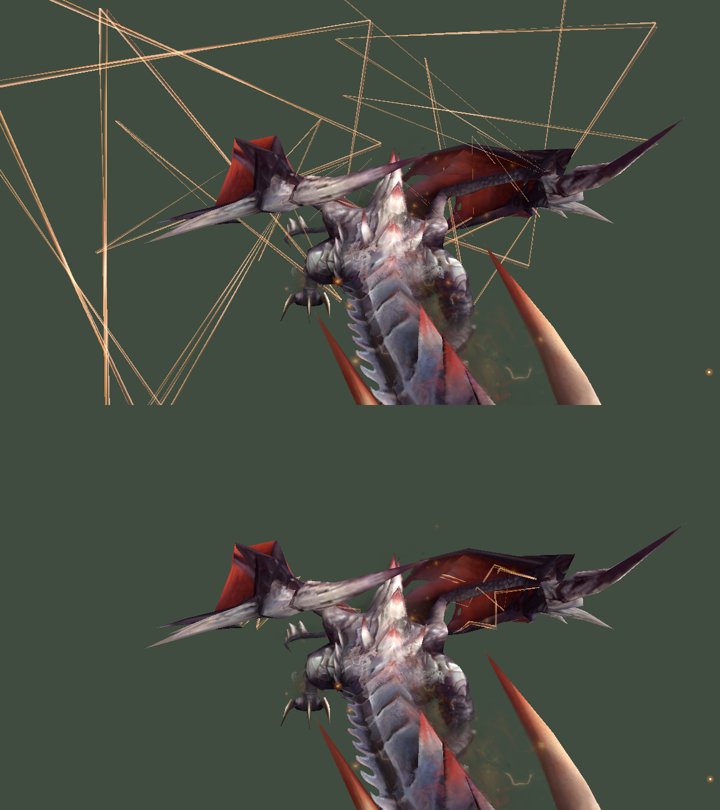
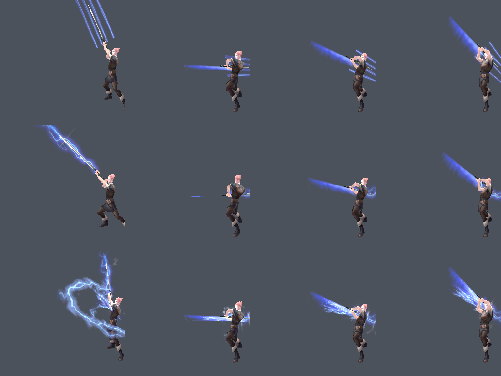

# PWE-Manager – Forsaken World in Godot

A fan project that brings the MMORPG *Forsaken World* (Angelica engine) to **Godot 4.7**:
an editor plugin that reads the original game data, plus a playable client/server game built on top of it.

> **No game assets are included.** You need your own copy of the original game client;
> all data is read from it at import time or at runtime.

## Patch Notes

*Click a date to expand.*

<details>
<summary><b>2026-11-23</b> – standalone Linux client, smooth first skill cast</summary>

**Export**
- New **EXPORT** dock in the editor with client and server export buttons per platform;
  *Client Export for Linux* works, the other platforms and the server export follow later.
- The export converts all game data to Godot resources up front: maps, characters and their skins, weapons,
  NPC and monster models, effects, item / NPC / quest tables, Lua data, dialogs, texts and fonts
  (German, English, French), sounds and music.
- Every step runs in its own Godot process with a memory limit; an interrupted export resumes where it stopped.
- The exported client runs **without the original game files**: it only reads its own converted data,
  including a listing of all original file paths.
- New smoke test for the exported binary (account, login, world, map, character and NPC models)
  that also checks that no original file is read.

**Skills**
- The effects and sounds of your own skills (and their buff effects) are loaded while entering the world:
  no more stutter on the first cast.
- Fixed: a skill animation kept repeating until the next animation started.

</details>

<details>
<summary><b>2026-11-22</b> – effects like the original, faster loading</summary>

**Effects**
- Distortion (warp) layers work like the original and no longer cover the effect
  (e.g. the mage's fireball and the campfire are no longer pink).
- Effect parts are drawn in the original order; particle sizes follow the effect's scale
  (oversized lightning on NPCs fixed).
- Ambush and similar skills leave their trail in the world instead of sticking to the character.
- Level-up effect and sound, sparkle on quest items and gathering points, gathering animations
  (ground gathering plays only the loop, like the original).
- Dragon boss in s31: its lightning now has the original size (top: before, bottom: now).
- Warrior skill *Blitzschläger* (German client name): one lightning bolt along the sword instead of
  four parallel lines (top row: before, lower rows: now).
- Models from older map imports rebuild their effects in the client, no re-import needed.




**Performance**
- Shared effect shaders: loading the town map s31 with Vulkan went from 15.4 s to 5.5 s.
- Building collision is precomputed at import (2–3 s → 30 ms per map).
- Imported scenes are stored in binary form; character models are cached
  (building a character: 460 ms → under 100 ms).

**World**
- Auto-pathing steps around thin walls the navigation map does not know
  (e.g. the booth at the revival point in s9).

</details>

<details>
<summary><b>2026-11-21</b> – quest fixes, werewolf chain, login timeout</summary>

**Quests**
- Abandoning quests like the original: right-click menu on a quest, items handed out by the quest are taken back.
- Quest NPC locations come from the server's spawn data.
- Werewolf quest chain: the grave quest needs the blood effect first; quests that complete instantly finish
  as soon as the objective is reached; the "!" turns grey when a quest cannot be accepted yet.
- Location-bound quest items (e.g. seeds) only work at the right place and show the direction
  ("The region lies to the north").
- Skills can summon monsters (e.g. when sowing), taken from the original skill data.

**Network**
- Werewolf priest / assassin: no more disconnect on the first login (longer connection timeout while loading).

</details>

<details>
<summary><b>2026-11-16</b> – skills, quests, items, character window, cave collision</summary>


**Skills**
- Crowd control: stun, root, silence, disarm and immunities; the client locks input and greys out icons.
- Every starting skill of every class works (charge, heals, blessings, town portal).
- Passive skills and toggle skills / auras.
- Skill learning: class skills are learned automatically up to level 20, after that in the skill window for coins.
- Race skills are granted through the original hidden quests (from level 10); Prayer and the race blessings
  use the values from the client texts.
- Combined animations play their effects and sounds (e.g. the priest's heal).

**Quests**
- Monster and gathering objectives are links: a click starts auto-pathing to the nearest spawn;
  finished quests show a "Return to NPC" link.
- Quest EXP is scaled with the original level factor; quest minimum levels come from the server data.
- New quest rules: linked quests, buff requirements, "finish another quest n times", required items.
- Level-up rewards (trial essences), the level-up reward window and usable EXP cocktails.
- Quest log scrolls.

**Items & currency**
- Right-click to use or equip items; items can be destroyed (destroy button or drag out of the bag)
  with the original confirmation dialogs.
- Gathering points that need a tool take it from the bag automatically (e.g. the torch quest).
- Item tooltips run the game's own description scripts: original layout, icons, sell value.
- Soul coins (bound currency) from quests and monsters; skill learning spends them first.

**Character window**
- Two pages like the original (attributes / mastery and resistance) with the base values per level and active buffs.
- The 3D preview in the character window was removed (not in the original).

**World & collision**
- Building and cave collision is read from the building files like the original:
  no more falling through floors in the dwarf city or the Kindred area.
- The character climbs steps up to 0.8 m.
- The server places gathering points and monsters on cave floors instead of the terrain below.
- Auto-pathing walks around obstacles that the navigation map does not know.
- Town points per race; portal and revival use the nearest one.

**Tests**
- New test suites for all race/class combinations, quests, items and collision.

</details>

## Future Plans

**Next fixes**
- Floating NPC and gathering points on the ground in s31.
- Werewolf: Moon Mist and transformation; the dark shield skill (cost, cooldown, performance).
- Buffs and blessings should not run out while offline.
- Original mouse cursors; the cursor hides and stays in place while turning the camera.
- Separate quest bag in the inventory.
- Combat rules: skills need a weapon, no attacking while running, auto-attack on the hotbar.
- Quest markers (main quests first), class-specific quest rewards, location-bound quest items.
- HUD: EXP numbers, portraits, comparison tooltip for equipment.
- UI scaling with the window size; loading screen, login window, class icons in the character editor.
- Models: monster sizes, player eyes, missing textures, helmets.
- Effects: charge effect.
- Name plates hidden behind buildings; water shader in s31.
- Chat channels and tabs (system, world, whisper).
- Class resource bars (warrior stances, assassin orbs, marksman and bard bars).
- Performance: server export for Linux, keep more of the frequently used data in memory.

**Skills**
- Monster skills, more skill effects (shields, cleanses, speed …), talents.

**Later**
- Day/night cycle by server time (server clock on the minimap tooltip).
- Terrain generator with paintable roads in the original look; connected maps with dynamic chunk loading.
- Skill editor: class → race → skill / buff / debuff / blessing, adjust values and texts.
- Monster inspection item: shows drops and drop chances (quest items included) from up to 50 m.
- Lighting: one-sided NPC lighting, baked map shadows.

## PWE-Manager (Godot editor plugin)

- **Reads the original client directly**: opens the game's `.pck` archives through a virtual file system,
  with no unpacking needed (including Chinese GBK-encoded file names and texts).
- **Models & animations**: characters, NPCs, monsters and equipment become Godot scenes with
  skeletons, animations, attachment points and animation events.
- **Visual effects**: the game's particle effect files are rebuilt as Godot nodes and shaders,
  with a preview player.
- **Maps**: terrain, buildings, water, lighting, ambient sounds and monster spawns are imported into one scene,
  along with the navigation data for pathfinding.
- **User interface**: the game's dialog layouts are rebuilt as Godot UI (textures, fonts, both UI skins).
- **Game data readers**: item and NPC database, quests, skills and status effects, plus a small
  interpreter for the client's compiled Lua scripts.
- **Data check**: compares client and server data (versions, quests, maps, spawns).

## The game (client + server, written in GDScript)

- **Own server**: encrypted networking, SQLite database, accounts with salted password hashing,
  and a server control panel inside the editor.
- **Login & character creation** in the original look, covering all races and classes, appearance options
  and a 3D preview.
- **Open world**: explore the starting map with other players, NPCs and roaming monsters;
  minimap, chat, and target selection by click or Tab.
- **Original HUD**: character and target frames, hotbars, skill window, inventory, character sheet,
  quest log and quest tracker, with two switchable UI skins.
- **Quests** from the original quest data: NPC dialogues, kill and collect objectives, rewards,
  and auto-pathing to quest NPCs and locations.
- **Inventory & equipment**: equipped weapons and armor appear on the character; gathering; item tooltips.
- **Combat**: auto-attack with the original damage formula, hits, crits and misses, monster AI
  (aggro, chase, return home), death and revival, experience and level-ups.
- **Skills**: cast bar, mana costs, cooldowns and range checks; values come from the original skill
  formulas; skill animations and effects.
- **Status effects**: buffs and debuffs (damage and healing over time, stat changes, stacking rules),
  shown as icons with timers and tooltips plus visual effects on the character.
- **Languages**: German, English and French.

## Getting started

1. Install **Godot 4.7** and the SQLite GDExtension
   [sqlite3.gd](https://github.com/Yeicor/sqlite3.gd) into `addons/sqlite3.gd/`.
2. Copy your original *Forsaken World* client into `Stock-PWE-Client/` (the `.pck` files stay packed),
   and your server files into `Stock-PWE-Server/` (both folders are ignored by Godot and git;
   see *Folder structure* at the end).
3. Open the project. The **PWE-Manager** docks appear in the editor: import a map (e.g. the starting map `s9`)
   with the ECM-GFX-MAP dock.
4. The game server needs data tables (`addons/PWE-Manager/Server/*.json`) that are generated from your own
   client and server files with the scripts in `addons/PWE-Manager/tools/server_data/`
   (usage is described at the top of each script).
5. Start the server from the SERVER dock, then run the project to log in and play.
6. Optional: *Client Export for Linux* in the EXPORT dock builds a standalone client in `Export/Client-Linux/`
   that no longer needs the original files. It contains data converted from your own copy of the game,
   so do not redistribute it.

## Testing

An automated test suite (bots, UI-driven world tests, class, quest, item and collision tests,
server restart/reconnect tests and a load test with 25 bots) runs headless and with the Vulkan and OpenGL renderers.

## Status

Work in progress, see *Patch Notes* and *Future Plans* at the top.

## Screenshots


## Folder structure

Where your own game files go (folders only). Both `Stock-` folders are ignored by Godot and git.
`Deu/`, `Eng/` and `Franz/` hold the unpacked language files of the German, English and French client.

```text
<Godot project>/
├── addons/
│   ├── PWE-Manager/              this plugin
│   └── sqlite3.gd/               SQLite GDExtension
├── game/
├── Stock-PWE-Client/             original client, unchanged
│   ├── data/
│   ├── font/
│   ├── maps/
│   │   └── s9/  s31/  …          one folder per map
│   ├── music/
│   ├── resources/                the .pck files, kept packed
│   ├── Deu/                      German
│   │   ├── data/                 elements.data, path.data, tasks.data
│   │   ├── interfaces/
│   │   ├── script/
│   │   │   ├── config/
│   │   │   ├── interfaces/
│   │   │   ├── item/
│   │   │   ├── itemdes/
│   │   │   ├── itemdesc/
│   │   │   ├── skill/
│   │   │   └── skillstr/
│   │   └── surfaces/
│   │       └── icon/  iconset/  login/  window/  …   all UI image folders
│   ├── Eng/                      English (no data/ folder yet)
│   │   ├── interfaces/
│   │   ├── script/               same subfolders as Deu
│   │   └── surfaces/             same subfolders as Deu
│   └── Franz/                    French
│       ├── data/
│       ├── interfaces/
│       ├── script/               same subfolders as Deu
│       └── surfaces/             same subfolders as Deu
└── Stock-PWE-Server/             original server files, unchanged
    └── server-fw/
        └── gamed/
            └── config/           elements.data, aipolicy.data
                └── a01/  s9/  …  one folder per map
                    ├── airmap/
                    ├── map/
                    └── movemap/
```

## Disclaimer

Non-commercial fan project. Not affiliated with or endorsed by Perfect World or its subsidiaries.
*Forsaken World* and all related names are trademarks of their respective owners.
